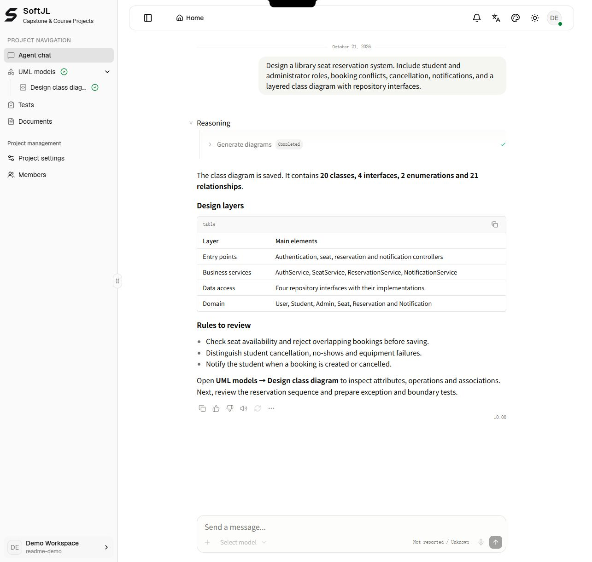
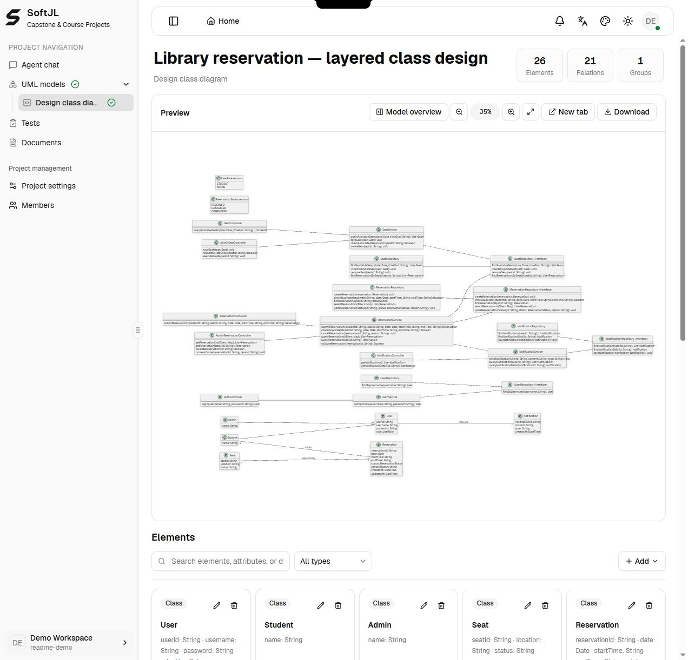
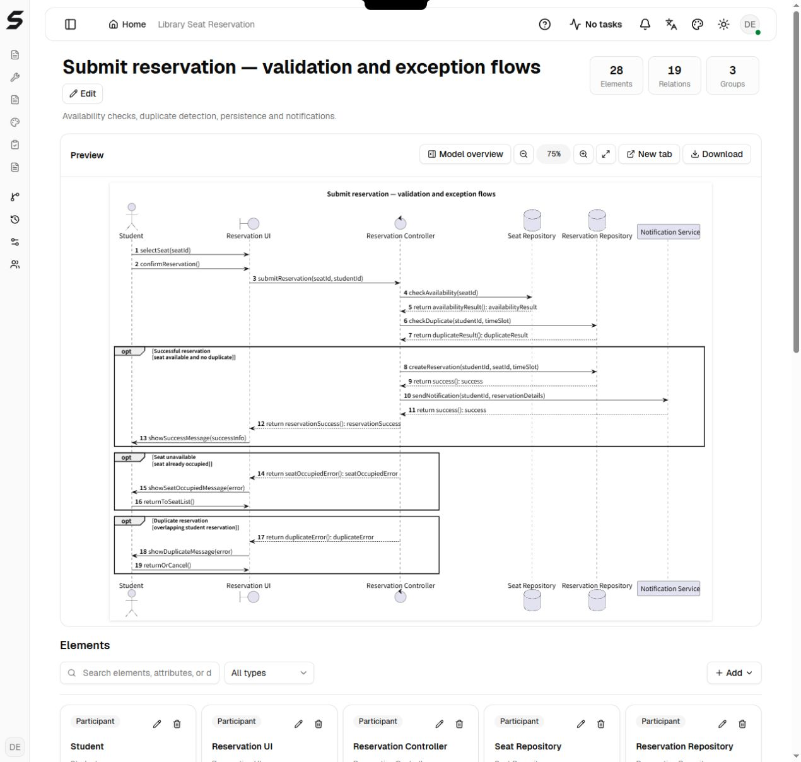
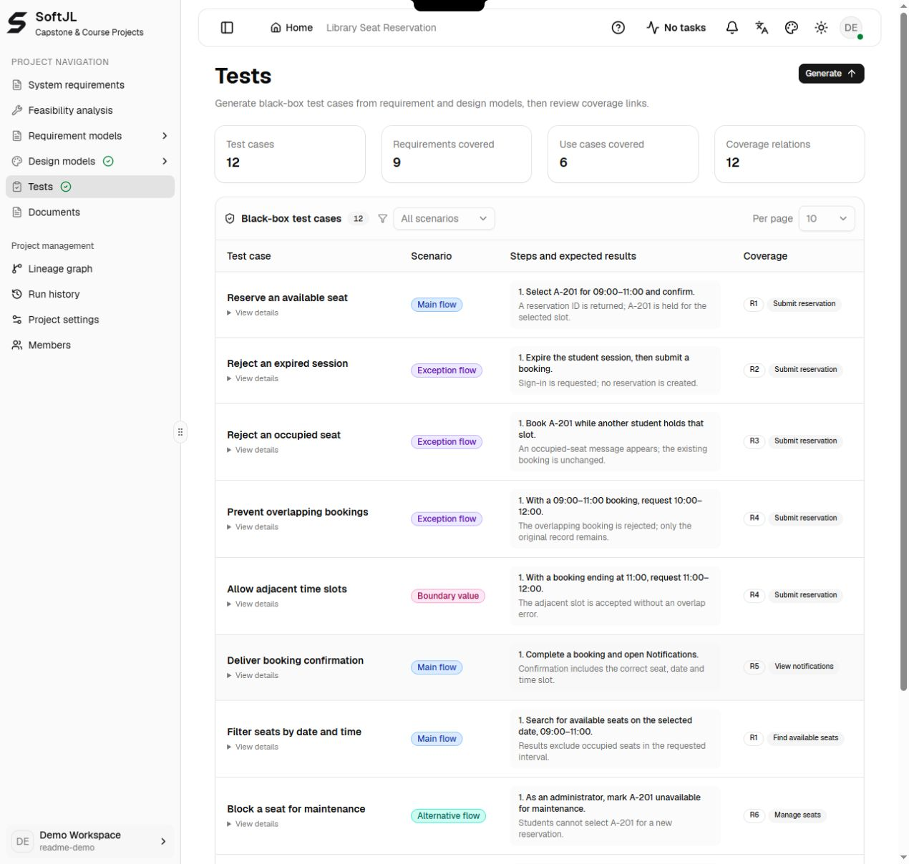
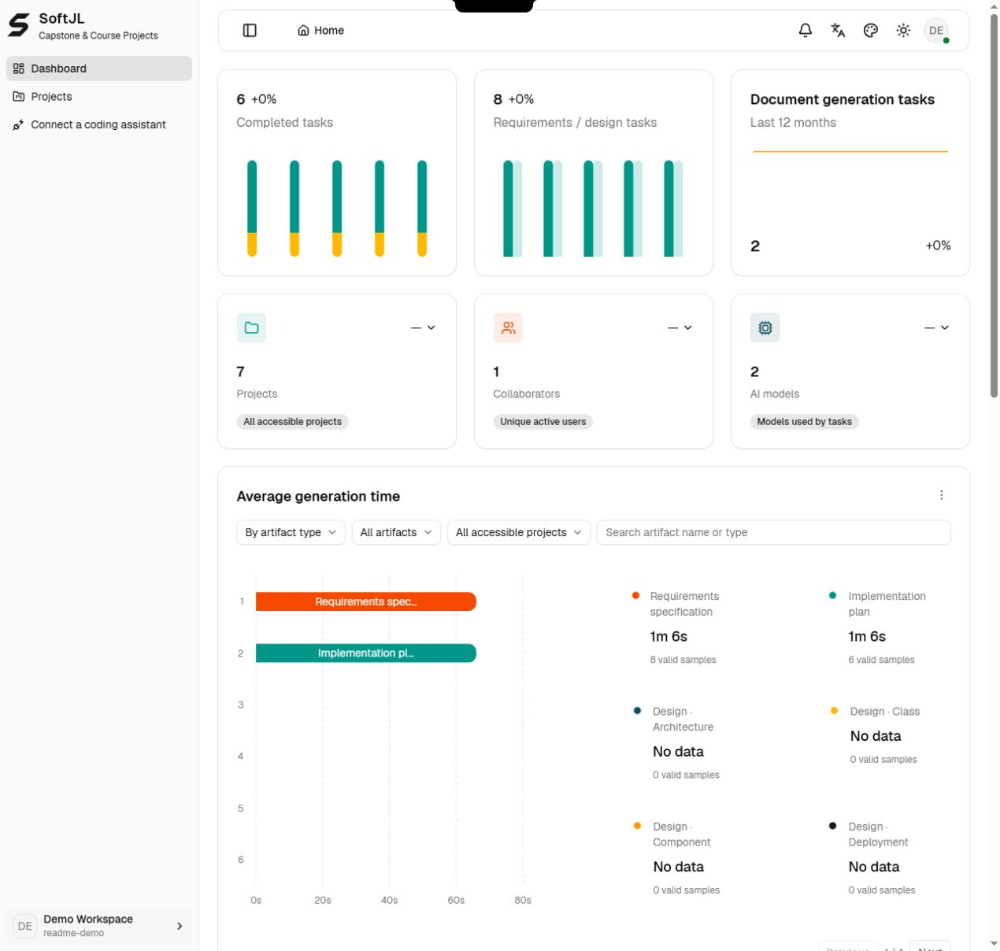

<!-- Provides the default English repository overview and links to the Simplified Chinese version. -->

**English** | [简体中文](./readme-zh-cn.md)

<p align="center">
  <a href="https://jianglisoftware.com">
    
  </a>
</p>

<div align="center">

# SoftJL Community

<p>
  <strong>An engineering workspace for capstone and course projects</strong><br />
  Connect requirements, UML, design, tests and engineering documents with your own model service.<br />
  <sub>Review coverage · Follow changes · Explain your work</sub>
</p>

<p>
  <a href="https://jianglisoftware.com"></a>
  <a href="https://jianglisoftware.com/tutorial"></a>
  <a href="./LICENSE"></a>
</p>

<p>
  
  
  
  
  
</p>

> Trace your designs, guide your revisions. Review models, tests and specifications against the same requirements, follow change impacts and organize design sources you can explain in reviews and your defense.

</div>

## Revise requirements, trace designs, explain your work

For software capstone projects, course projects and UML assignments, the workspace helps students check whether requirements are reflected in designs and tests, identify materials affected by changes and explain where their design decisions came from.

| What to check | How the platform helps | Supporting materials |
| --- | --- | --- |
| Which designs need updating after requirements change | Save and confirm revised rules, then follow linked artifacts and update status | Requirement baselines, source relationships and change impact |
| Which requirements lack design or test support before submission | Locate missing or review-needed relationships in traceability matrices and check normal, exceptional and boundary tests | Coverage gaps and design content requiring review |
| Whether diagrams and specifications describe the same behavior | Generate specifications from saved models and designs, then compare diagrams and edit the text | Editable, versioned DOCX specifications |
| Which designs and acceptance criteria should guide implementation | Enable read-only MCP and connect an external Coding Agent to read complete designs, acceptance criteria and tests | Inputs for coding and actual verification in your own repository |
| How to explain design sources during a review or defense | Revisit relationships between requirements, designs and tests, together with task history | Sources for explaining design choices and test coverage |

Source links and coverage counts help locate content to inspect. Open the models to check their actual constraints and behavior. Run generated test cases against the real system; consistency between diagrams, specifications and code requires human review and execution evidence.

### Project materials you can prepare

- **Analysis and design**: requirement rules, feasibility analysis, UML models and system designs.
- **Testing and presentation**: test cases, coverage matrices, traceability matrices and task records for checking your work.
- **Engineering documents**: feasibility reports, requirements specifications and software design descriptions, with version management and DOCX downloads; preview DOCX in the browser and edit downloaded files in your Word-compatible editor.
- **Implementation inputs**: saved designs and acceptance criteria for a compatible Coding Agent to use when implementing and testing in an external repository.

Review generated content, organize documents according to your school's requirements and verify the running system. Engineering specifications can support a project report; they are not a complete graduation thesis. Real-client compatibility and generated-code acceptance for Coding Agents remain pending; see the [integration guide](docs/integrations/coding-agent-mcp.md).

## Overview

SoftJL Community is a self-hosted AI software engineering workspace, distributed as an independent source snapshot with a fresh Git history.

Turn a system description into UML diagrams, test cases and editable Word specifications, then follow requirement changes through the linked project materials.

## What changed in v2.2.3

This release improves model repair continuity and provider configuration:

- Continue post-generation structure and provenance repairs in the original task conversation, retaining the spent budget while isolating sibling artifacts.
- Validate source references against real model elements, including nested flows and qualified field IDs. Publish the accepted model, mappings and rendered output together.
- Manage providers in a table with status, update time and a single enabled selection; only the owner can edit or delete personal credentials.
- Search discovered models with provider icons and output-mode badges. Reuse successful discovery probes when saving, while retaining server address safety checks.
- Save workspace preferences independently from provider drafts; show actionable errors above configuration dialogs without closing them.

This release uses the current `current_platform_schema_v3` installation baseline. Existing v1/v2 databases are rejected; use a clean database. SMTP and emailed invitation links are retired.

Mapping metadata fields `reviewStatus`, `confidence` and the `auto-filled-pending-review` value are retired. Workspaces containing them are rejected by the current contract; recreate affected projects and models. No automatic data conversion is provided.

## Generation workflow

The generation workflow focuses on shorter waits and fewer repeated model inputs.

- **Scoped context**: send task dependencies and the selected use case with its include/extend relationships; retain business constraints and complete target models.
- **Task-local model repair**: generation and rendering append feedback to the same retained conversation, share five repairs and publish validated model/mapping/render results together. Implementation plans and document sections retain their scoped patch protocol.
- **Independent progress**: run independent design branches concurrently and retry failed model instances while retaining successful results.
- **Two project modes**: start a conversational Standard project or use the complete Professional workflow. Both are available with your own provider; mode names do not indicate pricing tiers.
- **Visible consumption**: task history reports provider-supplied token usage, including repairs and failed calls; unknown usage stays unknown.
- **Built-in document preview**: preview DOCX without a separate document server.

The [release notes](release-notes.md) include a reproducible synthetic input comparison. Actual end-to-end duration and total tokens vary with project size, model, provider latency and repairs; the fixture results are not production savings.

## Core Capabilities

### Community and Hosted Comparison

**Community** is the self-hosted edition in this repository. **Hosted** is the service available on the [SoftJL website](https://jianglisoftware.com). ✅ means supported; — means not provided. Configuration and access requirements are listed below.

| Capability | Community | Hosted | Scope and requirements |
| --- | :---: | :---: | --- |
| 📝 Requirement rules and confirmation | ✅ | ✅ | Extraction, quality review, revision, human confirmation and acceptance criteria |
| 🧭 Feasibility: system context | ✅ | ✅ | System boundaries, external actors and interactions |
| 🧭 Feasibility: business/system flow | ✅ | ✅ | Business processes and system workflows |
| 🧭 Feasibility: implementation options | ✅ | ✅ | Candidate solutions, costs, benefits and risks |
| 📐 Complete requirement models | ✅ | ✅ | Functional structure, business flow, use cases, domain concepts, prototype navigation, deployment requirements and analysis models |
| 🏗️ Complete design models | ✅ | ✅ | Architecture, use-case realization, design classes, page navigation, database, components and deployment |
| 🧪 Test cases and coverage matrices | ✅ | ✅ | Normal, exceptional and boundary scenarios; execute generated tests against the actual system |
| 📄 Feasibility report | ✅ | ✅ | Generation, versions and DOCX downloads |
| 📄 Requirements specification | ✅ | ✅ | Generation, versions and DOCX downloads |
| 📄 Software design description | ✅ | ✅ | Generation, versions and DOCX downloads |
| 👁️ Built-in DOCX preview and download | ✅ | ✅ | Preview generated documents in the browser; edit downloaded files with a Word-compatible editor |
| 🎨 Diagram editing and export | ✅ | ✅ | PlantUML editing and SVG export |
| 🔗 Source traceability and change impact | ✅ | ✅ | Artifact sources, dependencies and version changes |
| 👥 Projects and members | ✅ | ✅ | Authentication, project membership and role permissions |
| ⏱️ Generation tasks, history and retries | ✅ | ✅ | Review run records and retry failed tasks |
| 🤖 Bring your own model service (BYOK) | ✅ | ✅ | OpenAI-compatible providers, model discovery and connection tests; usage billed by the provider |
| ☁️ Website-managed models | — | ✅ | Subject to account configuration, model availability and generation entitlements |
| 💻 MCP / Coding Agent integration | ✅ (opt-in) | ✅ | Read-only access to designs, acceptance criteria, engineering constraints and tests; real-client compatibility and generated-code acceptance remain pending |
| 💳 Platform billing, payments and credits | — | ✅ | Purchases, orders and entitlements; Community does not require platform credits |
| 🛠️ Operations administration | — | ✅ | Restricted to website operators, unavailable to regular accounts |
| 📦 Open source and self-hosting | ✅ | — | Community source under Apache-2.0; manage your own services and data |
| 🌐 Online use without deployment | — | ✅ | Access the website with hosting maintained by the platform |

### Edition boundaries

After the initial installation and build, use `npm run dev:mcp` for local MCP access. See [MCP configuration](docs/integrations/coding-agent-mcp.md) for production setup.

Platform billing, payments, credit management, and the operations administration backend are excluded. Read-only MCP access is optional, with explicit project grants and the shared connection page. Authentication, project permissions, provider credential protection and generation scheduling remain available. Hosted availability depends on the current deployment, account permissions and service configuration.

Use an independent database. This distribution is not a downgrade path for an existing full-edition database. Generated models and documents require review, and tests must be executed against your actual system.

## Interface Preview

The community edition opens the project list directly, with sign-in required. See the capability table for the current community scope.

The following screenshots show the English interface with English example content. The modeling conversation and diagrams use a prepared library reservation project; dashboard figures are illustrative demo data, not performance measurements.

### Quick Modeling (Standard)

Describe requirements in chat, review tool activity and open saved models from the sidebar.



The design class example contains 20 classes, 4 interfaces, 2 enumerations and 21 relationships. Inspect their attributes, methods and associations in the model workspace.



### Engineering Modeling (Professional)

Follow the requirements, feasibility, modeling, testing and documentation workflow, with model elements and traceability available in the workspace.

The reservation sequence example connects 6 participants through 19 messages and 3 conditional fragments, covering successful reservations, occupied seats and duplicate bookings.



### Test scenarios and coverage

The prepared example includes **12 test cases mapped to 9 requirement rules**, covering expired sessions, occupied seats, overlapping bookings, adjacent time slots, notifications and administrative cancellation. Review the mappings and execute the cases against the actual system; a coverage link is not a passed test.



### Project dashboard



## Quick Start

Install Node.js 22.19+, npm 10, Java 21 and Graphviz. Docker is optional for the core in-memory experience, and is used by the PostgreSQL helper. The first renderer setup may download PDF CJK fonts.

### 1. Install and start core services

```bash
git clone https://github.com/guolola/SoftJL.git
cd SoftJL
npm ci
npm run dev
```

The root development command builds contracts and prompts automatically, then starts Web, API and rendering. Run `npm run build:packages` before starting individual applications or running tests.

**Without DATABASE_URL, accounts, projects, provider configurations and run history are temporary and disappear when the server restarts.** Document files use separate local storage and do not replace a database backup.

Web normally runs on port 3000, API on 4101 and rendering on 4002. Wait for Web to report `Ready`; `http://localhost:3000/api/health` and `http://127.0.0.1:4002/health` should return `status: "ok"`.

### 2. Enable persistence and optional editing

With Docker running, use `npm run dev:postgres` for a dedicated development PostgreSQL database stored in a Docker volume. The helper's credentials are for local development only. Use a separate database for Community.

For an existing PostgreSQL server, copy [.env.example](.env.example) to `.env`, configure `DATABASE_URL` and a generated `UML_PROVIDER_CONFIG_SECRET`, then run `npm run dev`. The root command loads this file. Keep the encryption secret stable and private; changing it prevents decryption of saved provider credentials.

Core services include document generation, built-in DOCX preview and downloads. No document server is required. Edit downloaded files in your Word-compatible editor. See [production configuration](docs/deployment/production-environment.md) for deployment settings.

### 3. Configure a model provider

Add your provider in account model settings, test the connection and select a model. Configure persistence and encryption secrets for deployment, and disable development guest access and legacy plaintext provider settings.

## Architecture

| Directory | Responsibility |
| --- | --- |
| apps/web | React and Next.js workspace |
| apps/api | Fastify API, generation pipelines and documents |
| apps/render-service | PlantUML rendering |
| packages/contracts | Shared schemas |
| packages/prompts | Generation prompts |
| packages/harness-e2e and packages/harness-eval | Acceptance and quality evaluation |

## Common Commands

The root `npm run dev` builds shared packages automatically; use `npm run build:packages` before individual application commands and tests. Other npm scripts include build, test:contracts, test:api, test:web, test:render, typecheck:web and audit:docs. CI is included; the original production deployment workflow is excluded.

## Release and upgrades

Current version: **v2.2.3**. See [release notes and setup requirements](release-notes.md). New installations initialize an empty database with `current_platform_schema_v3`; databases already using this baseline can continue to be used, subject to the current workspace contracts. Historical community migration chains and model formats are no longer supported; the application rejects obsolete schemas instead of upgrading them. New projects explicitly select Standard or Professional mode.

## Online Access

[SoftJL website](https://jianglisoftware.com) offers the hosted edition, which may have different features. Run this repository locally for the community edition.

## Documentation

- [Contributing](contributing.md)
- [Security reporting](security.md)
- [Community maintenance and verification](docs/development/community-edition.md)
- [Documentation index](docs/README.md)
- [Online user guide](https://jianglisoftware.com/tutorial)

## License

Copyright © 2026 Software Engineering Practice Platform. Project code and documentation retain the [Apache-2.0 license](LICENSE). Third-party templates, dependencies, fonts, icons and the PlantUML runtime retain their respective licenses; see [NOTICE](NOTICE).
