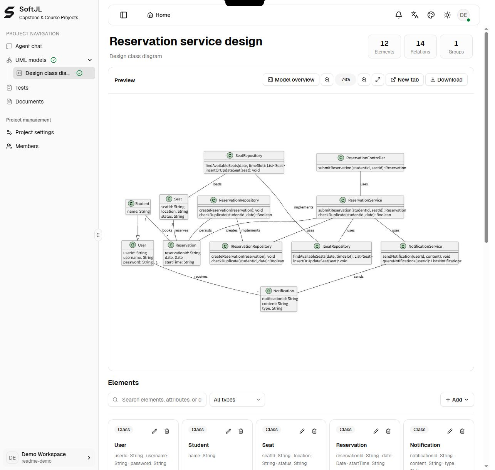

<!-- Introduces SoftJL through project outcomes, English interface examples and self-hosting instructions. -->

**English** | [简体中文](./readme-zh-cn.md)

<p align="center">
  
</p>

<div align="center">

# SoftJL Community

<p>
  <strong>Turn requirements into UML diagrams, test cases and Word specifications.</strong><br />
  An AI workspace for software engineering capstone and course projects.<br />
  <sub>Self-hosted · Bring your own model · Traceable designs · Editable DOCX exports</sub>
</p>

[Try the hosted app](https://jianglisoftware.com) · [Run locally](#quick-start) · [User guide](https://jianglisoftware.com/tutorial)

[](LICENSE)
[](release-notes.md)

</div>


**One reservation workflow: 6 participants, 19 messages and 3 conditional fragments.** Captured in the English interface using a prepared library reservation example.

## Overview

SoftJL connects requirements, models, tests and engineering documents in one self-hosted workspace. Use **Standard** for conversational modeling, or **Professional** for the staged requirements, feasibility, design and documentation workflow. Both modes support your own provider; their names are not pricing tiers.

- **Build project materials** — prepare UML models, system designs, normal/exception/boundary test cases and downloadable DOCX specifications.
- **Follow requirement changes** — inspect source relationships and update status to find designs and tests that need review after a requirement changes.
- **Explain design decisions** — revisit requirements, design sources and task history when preparing a project review or defense.

Review the generated artifacts and execute tests against your actual system. Specifications can support a project report; they are not a complete graduation thesis.

### Walk through a library reservation project

> Students sign in, find available seats and book a date and time slot. Reject occupied seats and overlapping bookings. Send notifications after booking or cancellation. Administrators maintain seats, review reservations and handle no-shows or equipment failures.

| Step | What you do | What you can inspect |
| --- | --- | --- |
| 1 | Describe the system and confirm its rules | Actors, constraints and acceptance criteria |
| 2 | Complete feasibility and generate models | Use cases, classes, sequence diagrams and their sources |
| 3 | Prepare tests and specifications | Scenario coverage, document preview and DOCX downloads |
| 4 | Revise a rule and follow dependencies | Affected artifacts to review and update |

## Online Access

**[Open the hosted app](https://jianglisoftware.com)** to explore without installing local services. Sign-in, available models and generation entitlements depend on the hosted account. **[Run Community locally](#quick-start)** to use your own model service and manage your own data. Model calls are billed by your provider.

## Quick Start

Install Node.js 22.19+, npm 10, Java 21 and Graphviz. Docker is optional for the core in-memory experience, and is used by the PostgreSQL helper. The first renderer setup may download PDF CJK fonts.

### 1. Install and start core services

```bash
git clone https://github.com/guolola/SoftJL.git
cd SoftJL
npm ci
npm run dev
```

The root development command builds contracts and prompts automatically, then starts Web, API and rendering. Run `npm run build:packages` before starting individual applications or running tests.

**Without DATABASE_URL, accounts, projects, provider configurations and run history are temporary and disappear when the server restarts.** Document files use separate local storage and do not replace a database backup.

Web normally runs on port 3000, API on 4101 and rendering on 4002. Wait for Web to report `Ready`; `http://localhost:3000/api/health` and `http://127.0.0.1:4002/health` should return `status: "ok"`.

### 2. Enable persistence and optional editing

With Docker running, use `npm run dev:postgres` for a dedicated development PostgreSQL database stored in a Docker volume. The helper's credentials are for local development only. Use a separate database for Community.

For an existing PostgreSQL server, copy [.env.example](.env.example) to `.env`, configure `DATABASE_URL` and a generated `UML_PROVIDER_CONFIG_SECRET`, then run `npm run dev`. The root command loads this file. Keep the encryption secret stable and private; changing it prevents decryption of saved provider credentials.

Core services include document generation, built-in DOCX preview and downloads. No document server is required. Edit downloaded files in your Word-compatible editor. See [production configuration](docs/deployment/production-environment.md) for deployment settings.

### 3. Configure a model provider

Add your provider in account model settings, test the connection and select a model. Configure persistence and encryption secrets for deployment, and disable development guest access and legacy plaintext provider settings.

## Interface Preview

### Inspect a layered reservation design

A focused Standard-mode example with **10 classes, 2 repository interfaces and 14 relationships**: controller, services, repositories, students, seats, reservations and notifications. Attributes and operations remain visible alongside model editing controls.



### Review normal, exceptional and boundary tests

The example includes **12 cases mapped to 9 requirement rules**: expired sessions, occupied seats, duplicate bookings, adjacent time slots, notifications and administrative cancellation. Mapping status is pending review; a coverage link does not mean a test has passed.


## Core Capabilities

| Capability | What Community provides |
| --- | --- |
| Requirements and feasibility | Extract and confirm rules; analyze system context, business flow and implementation options. |
| UML and system design | Model use cases, classes, interactions, architecture, database, components and deployment; edit PlantUML and export SVG. |
| Testing and traceability | Prepare scenario-based tests, inspect source mappings, coverage gaps and changes. |
| Word documents | Professional: feasibility report, requirements specification and software design description. Standard: requirements and design specifications. Preview in the browser, download DOCX and edit in a Word-compatible editor. |
| Your model and your deployment | OpenAI-compatible providers, model discovery, connection checks, task history and retries. |
| Project collaboration | Authentication, project membership, role permissions and provider credential protection. |
| Optional MCP integration | Read-only project access to designs, acceptance criteria and tests, with explicit grants. Real-client compatibility and generated-code acceptance remain pending. |

### Community and hosted editions

Community includes the engineering workspace and BYOK generation without platform credits. The hosted service additionally manages hosting, website models, billing and generation entitlements. Platform payments, credit management and the operations backend are excluded from this repository. Hosted capabilities depend on the deployment and account permissions.

After installation, use `npm run dev:mcp` to enable local MCP. See the [MCP integration guide](docs/integrations/coding-agent-mcp.md) for grants and production configuration.

## Release and upgrades

Current version: **v2.2.3**, with model repair continuity and improved provider configuration. See [release notes and upgrade requirements](release-notes.md).

**Deployment and upgrade requirements:** use an independent database and the `current_platform_schema_v3` baseline. Older database schemas are rejected. Workspace mappings containing `reviewStatus`, `confidence` or `auto-filled-pending-review` are no longer accepted; affected projects/models must be recreated. No automatic data conversion is provided. Community is not a downgrade path for a full-edition database.

## Architecture

| Directory | Responsibility |
| --- | --- |
| apps/web | React and Next.js workspace |
| apps/api | Fastify API, generation pipelines and documents |
| apps/render-service | PlantUML rendering |
| packages/contracts | Shared schemas |
| packages/prompts | Generation prompts |
| packages/harness-e2e and packages/harness-eval | Acceptance and quality evaluation |

## Common Commands

Build shared packages before starting individual applications or tests. The root `npm run dev` does this automatically.

| Command | Purpose |
| --- | --- |
| `npm run build:packages` | Build shared contracts and prompts |
| `npm run build` | Build all applications |
| `npm run test:web` | Run frontend tests |
| `npm run typecheck:web` | Check frontend types |
| `npm run test:harness-e2e` | Run browser acceptance checks |
| `npm run audit:docs` | Check documentation structure and links |

For API, rendering, deployment and maintenance checks, see [Contributing](contributing.md) and [Community maintenance](docs/development/community-edition.md).

## Documentation

- [Contributing](contributing.md)
- [Security reporting](security.md)
- [Community maintenance and verification](docs/development/community-edition.md)
- [Documentation index](docs/README.md)
- [Online user guide](https://jianglisoftware.com/tutorial)

## License

Copyright © 2026 Software Engineering Practice Platform. Project code and documentation retain the [Apache-2.0 license](LICENSE). Third-party templates, dependencies, fonts, icons and the PlantUML runtime retain their respective licenses; see [NOTICE](NOTICE).
