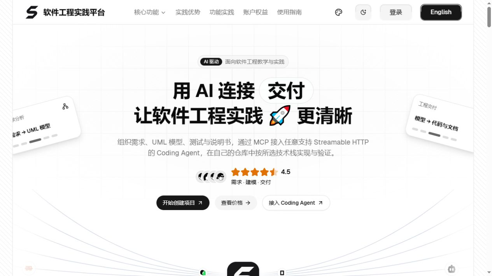
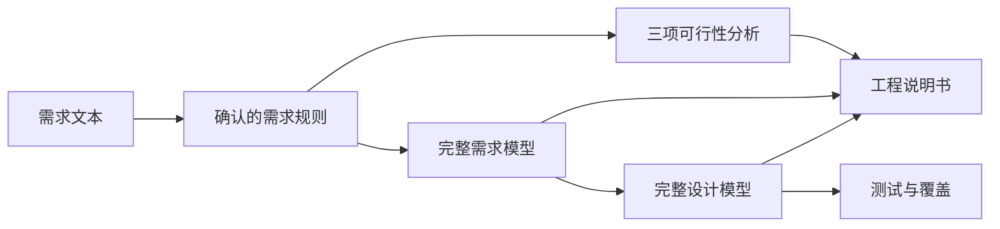

<!-- 提供默认中文仓库首页，并通过 readme-en.md 提供英文版本。 -->

**简体中文** | [English](./readme-en.md)

<p align="center">
  <a href="https://jianglisoftware.com">
    
  </a>
</p>

<div align="center">

# SoftJL Community

<p>
  <strong>面向毕设与课程设计的工程实践工作台</strong><br />
  用 AI 关联需求、UML、设计、测试与说明书，提供检查与修改依据，支持自带模型与独立部署<br />
  <sub>检查覆盖 · 查看更新影响 · 梳理答辩依据</sub>
</p>

<p>
  <a href="https://jianglisoftware.com"></a>
  <a href="https://jianglisoftware.com/tutorial"></a>
  <a href="./LICENSE"></a>
</p>

<p>
  
  
  
  
  
</p>

> 设计有依据，修改有方向。围绕同一份需求检查模型、测试和说明书，查看修改影响，整理汇报与答辩时能讲清的设计依据。

</div>

## 项目简介

需求改得动，设计查得到，答辩讲得清。

SoftJL Community 是可独立部署的 AI 软件工程工作台，保留从需求分析到工程文档的完整实践流程。社区版来自 SoftJL 的独立源码快照，使用新的提交历史维护。

## 核心能力

| 阶段 | 社区版保留的能力 | 产物 |
| --- | --- | --- |
| 📝 需求规则 | 提取、质量检查、修订与人工确认 | 需求基线、规则与验收条件 |
| 🧭 三项可行性分析 | 系统环境图、业务与系统流程图、实现方案 | 图表、候选方案、成本收益与风险分析 |
| 📐 完整需求模型 | 功能结构、总体业务流程、用例、领域概念、原型界面关系、部署需求、需求分析模型 | 结构化模型、PlantUML、SVG |
| 🏗️ 完整设计模型 | 总体架构、用例实现、设计类、页面导航、数据库、组件关系、部署设计 | 设计模型、图表与追踪关系 |
| 🧪 测试与覆盖 | 测试用例、场景和覆盖矩阵 | 正常、异常与边界测试依据 |
| 📄 工程说明书 | 可行性研究报告、需求规格说明书、软件设计说明书 | DOCX、版本管理；配置 OnlyOffice 后在线编辑 |
| 🔗 项目工作区 | 项目与成员管理、任务历史、重试、来源追踪、图表编辑导出 | 项目资料与运行记录 |
| 🤖 自带模型 | OpenAI 兼容供应商配置、模型发现与连接测试 | 自己的模型服务与默认模型 |

### 社区版范围

社区版不提供平台计费、支付、充值与额度系统，不包含运营后台以及 MCP / Coding Agent 接入服务。项目成员权限、账号认证、模型密钥保护和生成调度继续保留。移除的能力同时从页面入口、服务接口与对应实现中裁剪。

在线官网展示的是托管版，功能可能不同。社区版无需购买平台生成次数；真实模型调用费用由你选择的模型供应商结算。请使用独立数据库部署社区版，不要将它作为完整版数据库的降级替代。

## 用图书馆座位预约系统走一遍

```text
学生登录后查询空闲座位，选择日期和时间段提交预约。
同一学生同一时间段不能重复预约。预约成功后，系统发送通知。
管理员可以维护座位、查看预约记录，并处理异常取消。
```

1. 创建项目并配置模型，输入需求、提取并确认规则。
2. 完成三项可行性分析，核对系统边界、流程和实现方案。
3. 生成需求模型，再按前置条件生成设计模型，查看来源关系。
4. 生成测试用例并检查覆盖；生成、检查并下载三类说明书。
5. 需求变更后按依赖顺序更新受影响产物，在实际系统中执行测试。

图表与覆盖数量帮助定位检查内容，生成结果仍需人工评审。测试用例需在实际系统执行，工程说明书可作为项目报告材料。

## 界面预览

<p align="center"><strong>官网首页与项目工作台预览</strong></p>

### 🌐 官网首页



沿用 SoftJL 的视觉与历史截图；社区版的功能范围以本页说明为准，托管版入口可能与自部署版本不同。

### 项目仪表盘

下图为仪表盘统计区域截图。数值取决于账号可访问的项目与任务记录，不是上述操作案例的生成结果。


<details>
<summary>生成耗时的统计口径</summary>

**平均生成耗时**图表按产物统计：模型从子任务进入运行到产物就绪；可行性产物从对应生成阶段开始到产物就绪；说明书从正文生成阶段开始到文件生成并保存完成，包含这段期间适用的修复、审查与渲染。旧记录若只有独立生成调用的起止时间，则使用该调用边界；缺失或无效时间不计入均值，并行模型各自计时。项目列表按成功完成的整次任务计算平均耗时，从第一个阶段开始到任务完成；最近任务显示到完成、失败或取消的时长。首阶段开始前的排队等待不计入。

</details>

## 技术架构



| 目录 | 职责 |
| --- | --- |
| apps/web | React、Next.js 工作区与应用内教程 |
| apps/api | Fastify、认证、生成流水线、记录与文档组装 |
| apps/render-service | PlantUML 图形渲染 |
| packages/contracts、packages/prompts | 共享契约与生成提示 |
| packages/harness-e2e、packages/harness-eval | 验收与质量评估 |

## 快速开始

### 1. 准备环境

| 依赖 | 建议版本 | 用途 |
| --- | --- | --- |
| Node.js | 22 | 应用与工具链运行时 |
| npm | 10 | Monorepo 依赖与脚本 |
| Java | 21 | PlantUML 运行时 |
| Graphviz | 当前稳定版 | PlantUML 图布局 |
| Docker Desktop | 可选 | 本地 OnlyOffice 在线编辑 |

### 2. 获取并安装

```bash
git clone https://github.com/guolola/SoftJL-community.git
cd SoftJL-community
npm ci
```

### 3. 启动完整开发环境

```bash
npm run dev
```

启动脚本会检查本地 OnlyOffice，并并行启动 Web、API 和渲染服务。

| 服务 | 本地地址或端口 |
| --- | --- |
| Web | Next.js 输出地址，通常为 `http://localhost:3000` |
| API | 安全开发配置使用 `4101` |
| Render Service | `4002` |
| OnlyOffice | `8080` |

### 4. 配置模型服务

登录后在账号设置中新增 OpenAI 兼容 Provider，填写供应商 HTTPS Base URL 与 API Key，完成模型发现和连接测试后选择默认模型。自部署使用自己的模型服务，费用由供应商账户结算。生产环境配置持久化数据库、凭据加密密钥，并关闭开发访客和 legacy 明文回退入口。

## 常用命令

### 开发与构建

| 命令 | 用途 |
| --- | --- |
| `npm run dev` | 启动完整本地开发环境 |
| `npm run dev:postgres:demo` | 启动带就绪检查的 PostgreSQL 演示环境 |
| `npm run dev:api:safe` | 以安全开发配置单独启动 API |
| `npm run dev:render` | 单独启动 PlantUML 渲染服务 |
| `npm run dev:web:safe` | 以安全开发配置单独启动 Web |
| `npm run build` | 构建共享包和全部应用 |
| `npm run build:web:production` | 按生产站点配置构建 Web |

### 测试与治理

| 命令 | 用途 |
| --- | --- |
| `npm run test:contracts` | 验证共享契约 |
| `npm run test:api` | 运行 API 测试 |
| `npm run test:render` | 运行渲染服务测试 |
| `npm run test:web` | 运行完整 Web 测试 |
| `npm run test:harness-e2e` | 构建生产 Web 产物并运行本地浏览器验收 |
| `npm run typecheck:web` | 检查 Web 类型 |
| `npm run test:deploy` | 验证部署辅助程序 |
| `npm run audit:architecture` | 检查架构边界 |
| `npm run audit:docs` | 检查文档命名、结构、链接和杂物 |

> 构建输出、生成的文档模块、根目录 `.local-*` 临时文件、环境配置、私钥、日志和本地运行数据保持 Git 忽略。

## 在线访问

[SoftJL 官网](https://jianglisoftware.com)提供托管版体验，功能可能与本社区版不同。社区版按上方快速开始在本机运行。

## 文档导航

保留持续集成测试，社区版不附带原站点的自动生产发布工作流。部署前将服务域名、数据库、邮件与模型配置替换成自己的环境；开发启动配置仅供本机使用。

- [社区版维护与验证](docs/development/community-edition.md)
- [文档索引](docs/README.md)
- [快速开始教程](apps/web/src/features/product-docs/content/quick-start.md)
- [模型服务接入](docs/integrations/openai-compatible-provider.md)

## 授权

<div align="center">

**Copyright © 2026 软件工程实践平台 · Apache-2.0**

本项目自有代码与文档采用 [Apache License 2.0](LICENSE)，允许商业使用、修改和再分发，也允许闭源修改与分发，但须遵守保留许可与相关声明、标明修改等协议条件。

第三方依赖、字体、图标及 PlantUML 运行时保留各自的版权与许可，不因本项目协议变更而重新授权。相关声明与许可位置见 [NOTICE](NOTICE)；再分发时还须遵守对应组件的许可条件。

</div>
