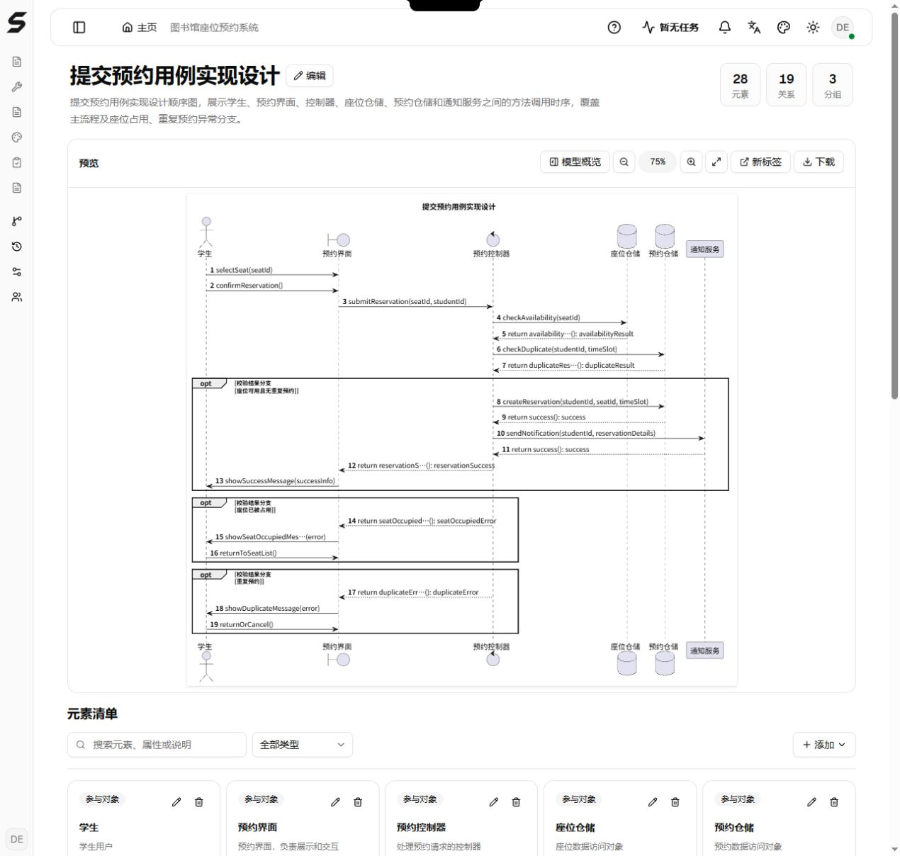
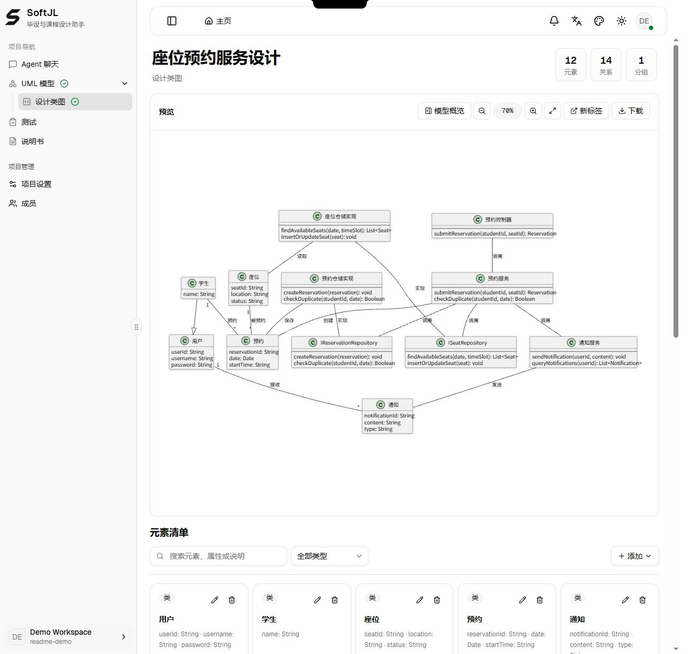
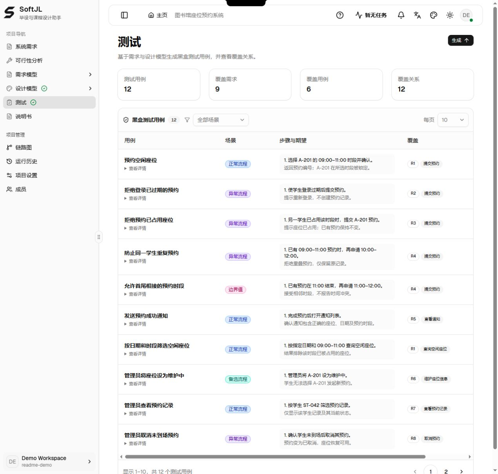
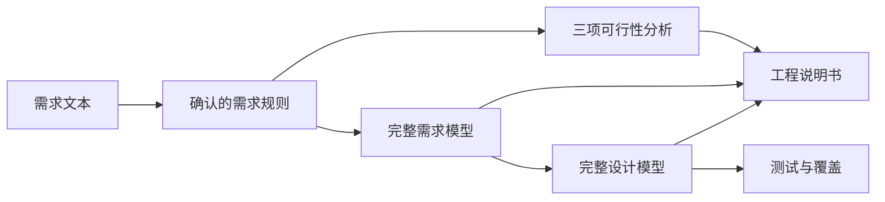

<!-- 说明 SoftJL 的项目成果、中文界面示例与独立部署方式。 -->

[English](./README.md) | **简体中文**

<p align="center">
  
</p>

<div align="center">

# SoftJL Community

<p>
  <strong>从需求到 UML、测试用例与 Word 说明书。</strong><br />
  面向软件类毕设与课程设计的 AI 工作台。<br />
  <sub>独立部署 · 自带模型 · 设计可追踪 · DOCX 导出后可编辑</sub>
</p>

[在线体验](https://jianglisoftware.com) · [本地部署](#快速开始) · [使用手册](https://jianglisoftware.com/tutorial)

[](LICENSE)
[](release-notes.md)

</div>



**一个预约流程，6 个参与者、19 条消息、3 个条件分支。** 使用准备好的图书馆座位预约示例，在应用中文界面中实际截取。

## 项目简介

SoftJL 将需求、模型、测试与工程说明书组织在同一个可独立部署的工作区。**快速建模（普通版项目）**通过对话按需生成图表；**工程建模（专业版项目）**按需求、可行性、设计和文档流程推进。两种模式均支持自带模型，名称不表示付费档位。

- **生成项目材料** — 整理 UML 模型、系统设计、正常/异常/边界测试用例，以及可下载的 DOCX 说明书。
- **定位修改影响** — 沿来源关系与更新状态，查找需求变化后需要复核的设计和测试。
- **梳理答辩依据** — 回看需求、设计来源与任务历史，准备项目汇报与答辩。

需求改得动，设计查得到，答辩讲得清。生成内容仍需人工评审，测试用例需要在实际系统执行；工程说明书可以支持项目报告，不等同于完整毕业论文。

### 用图书馆座位预约系统走一遍

> 学生登录后查询空闲座位，选择日期和时段预约；系统拒绝已占用座位和重复预约，在成功预约或取消后发送通知。管理员维护座位、查看预约，并处理未到场或设备故障导致的取消。

| 步骤 | 操作 | 可检查的成果 |
| --- | --- | --- |
| 1 | 描述系统并确认需求规则 | 角色、约束与验收条件 |
| 2 | 完成可行性分析，生成需求与设计模型 | 用例、类图、时序图及来源关联 |
| 3 | 准备测试与工程说明书 | 场景覆盖、文档预览与 DOCX 下载 |
| 4 | 修改规则后沿依赖更新 | 需要复核与更新的关联产物 |

## 在线访问

**[打开在线平台](https://jianglisoftware.com)**，免部署探索功能；登录、可用模型和生成权益以官网账号配置为准。也可以按下方步骤**[独立部署社区版](#快速开始)**，使用自己的模型服务并管理数据；模型调用费用由供应商结算。

## 快速开始

### 1. 准备环境

安装 Node.js 22.19+、npm 10、Java 21 和 Graphviz。Docker 用于可选的 PostgreSQL，本地临时体验无需 Docker。首次渲染服务安装可能下载 PDF 中文字体，需要网络。

### 2. 安装并启动核心服务

```bash
git clone https://github.com/guolola/SoftJL.git
cd SoftJL
npm ci
npm run dev
```

`npm run dev` 自动构建 contracts 和 prompts，再并行启动 Web、API 与渲染服务。单独启动应用或运行测试前，使用 `npm run build:packages` 构建共享包。

**默认是临时内存模式：服务重启后，账号、项目、模型服务配置与运行历史会丢失。** 文档文件单独保存在本地目录，不能替代数据库备份。准备长期使用时先完成下一步的持久化配置。

| 服务 | 本地地址或端口 |
| --- | --- |
| Web | Next.js 输出地址，通常为 `http://localhost:3000` |
| API | `4101` |
| Render Service | `4002` |

Web 输出 `Ready` 后打开首页；`http://localhost:3000/api/health` 和 `http://127.0.0.1:4002/health` 应返回 `status: "ok"`。核心服务支持生成、内置 DOCX 预览与下载，无需额外文档服务器。

### 3. 选择持久化

本机安装 Docker 后，运行 `npm run dev:postgres` 启动专用开发数据库和核心服务，数据库保存在 Docker 数据卷。脚本中的数据库凭据仅适用于本机开发，生产环境必须替换。不要把已有完整版数据库用于社区版。

已有 PostgreSQL 时，将根目录 [.env.example](.env.example) 复制为 `.env`，设置 `DATABASE_URL` 和自己生成的 `UML_PROVIDER_CONFIG_SECRET`，再运行 `npm run dev`。根目录启动入口加载该文件；密钥与数据库连接配置不要提交。保管加密密钥，随意更换会使已保存的供应商凭据无法解密。

文档生成后可直接在浏览器预览 DOCX，并下载到本地修改。`npm run dev:full` 保留为核心服务的兼容启动别名。生产配置见 [生产环境配置](docs/deployment/production-environment.md)。

### 4. 配置模型服务

登录后在账号设置中新增 OpenAI 兼容 Provider，填写供应商 HTTPS Base URL 与 API Key，完成模型发现和连接测试后选择默认模型。自部署使用自己的模型服务，费用由供应商账户结算。生产环境配置持久化数据库、凭据加密密钥，并关闭开发访客和 legacy 明文回退入口。

## 界面预览

### 查看分层的预约服务设计

快速建模中的局部设计示例，包含 **10 个类、2 个仓储接口、14 条关系**，覆盖控制器、业务服务、数据访问、学生、座位、预约与通知，可继续检查属性、方法和关联。



### 复核正常、异常与边界测试

示例包含 **12 个测试用例，关联 9 条需求规则**，涉及登录过期、座位占用、重复预约、相邻时段、通知及管理员取消。来源映射保留待复核状态；建立关联不等于测试已执行通过。



## 核心能力

| 能力 | 社区版提供什么 |
| --- | --- |
| 需求与可行性 | 提取与确认规则；分析系统环境、业务流程与实现方案。 |
| UML 与系统设计 | 建模用例、类、交互、架构、数据库、组件与部署；编辑 PlantUML、导出 SVG。 |
| 测试与来源追踪 | 准备场景测试，查看来源映射、覆盖缺口及变更影响。 |
| Word 工程文档 | 工程建模支持可行性研究报告、需求规格说明书、软件设计说明书；快速建模支持需求与设计说明书。浏览器内预览，下载 DOCX 后使用 Word 兼容编辑器修改。 |
| 自带模型与独立部署 | OpenAI 兼容供应商、模型发现、连接检查、任务历史与重试。 |
| 项目协作 | 账号认证、项目成员、角色权限及供应商凭据保护。 |
| 可选 MCP 接入 | 明确授权项目范围后，只读提供设计、验收条件与测试；真实客户端兼容性及生成代码验收仍待完成。 |

### 社区版与官网版

社区版提供工程工作区与自带模型生成，无需购买平台生成次数。官网版另行提供托管服务、网站模型、账单与生成权益。本仓库不包含平台支付、充值额度及运营后台；官网能力以部署配置与账号权限为准。

完成安装后可用 `npm run dev:mcp` 启用本地 MCP；授权范围与生产配置见 [MCP 接入说明](docs/integrations/coding-agent-mcp.md)。

## 版本与升级

当前版本为 **v2.2.3**，改进模型修复连续性与供应商配置体验，详见 [发布说明与升级要求](release-notes.md)。

**部署与升级要求：**使用独立数据库及 `current_platform_schema_v3` 基线；旧数据库结构会被拒绝。包含 `reviewStatus`、`confidence` 或 `auto-filled-pending-review` 的旧来源映射不再被接受，需重建受影响的项目与模型，不提供自动数据转换。社区版不能作为完整版数据库的降级替代。

## 技术架构



| 目录 | 职责 |
| --- | --- |
| apps/web | React、Next.js 项目工作区 |
| apps/api | Fastify、认证、生成流水线、记录与文档组装 |
| apps/render-service | PlantUML 图形渲染 |
| packages/contracts、packages/prompts | 共享契约与生成提示 |
| packages/harness-e2e、packages/harness-eval | 验收与质量评估 |

## 常用命令

单独启动应用或运行测试前先构建共享包；根目录 `npm run dev` 会自动完成构建。

| 命令 | 用途 |
| --- | --- |
| `npm run build:packages` | 构建共享契约与提示词 |
| `npm run build` | 构建全部应用 |
| `npm run test:web` | 运行前端测试 |
| `npm run typecheck:web` | 检查前端类型 |
| `npm run test:harness-e2e` | 运行浏览器验收 |
| `npm run audit:docs` | 检查文档结构与链接 |

API、渲染、部署与维护检查见 [贡献指南](contributing.md)及 [社区版维护与验证](docs/development/community-edition.md)。

## 文档导航

保留持续集成测试，社区版不附带原站点的自动生产发布工作流。部署前将服务域名、数据库与模型配置替换成自己的环境；开发启动配置仅供本机使用。

- [贡献指南](contributing.md)
- [安全问题披露](security.md)
- [社区版维护与验证](docs/development/community-edition.md)
- [文档索引](docs/README.md)
- [线上使用指南](https://jianglisoftware.com/tutorial)
- [模型服务接入](docs/integrations/openai-compatible-provider.md)

## 授权

<div align="center">

**Copyright © 2026 软件工程实践平台 · Apache-2.0**

本项目自有代码与文档采用 [Apache License 2.0](LICENSE)，允许商业使用、修改和再分发，也允许闭源修改与分发，但须遵守保留许可与相关声明、标明修改等协议条件。

第三方模板、依赖、字体、图标及 PlantUML 运行时保留各自的版权与许可，不因本项目协议变更而重新授权。相关声明与许可位置见 [NOTICE](NOTICE)；再分发时还须遵守对应组件的许可条件。

</div>
