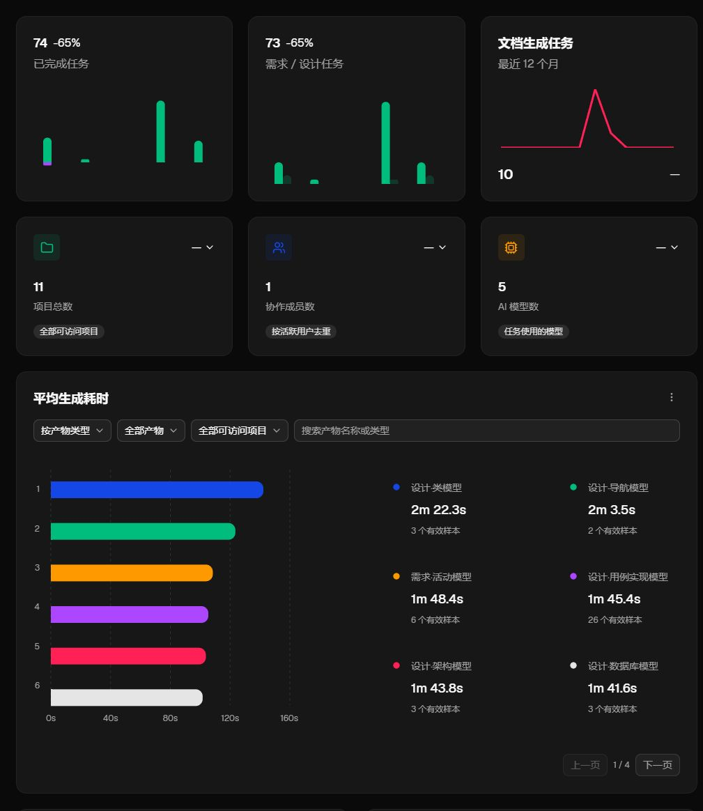
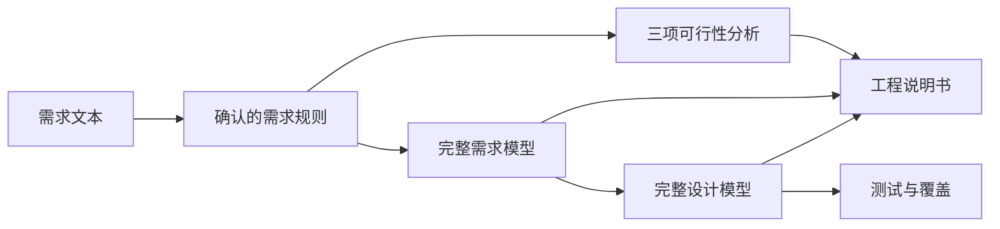

<!-- 提供简体中文项目介绍，并链接默认英文仓库首页。 -->

[English](./README.md) | **简体中文**

<p align="center">
  <a href="https://jianglisoftware.com">
    
  </a>
</p>

<div align="center">

# SoftJL Community

<p>
  <strong>面向毕设与课程设计的工程实践工作台</strong><br />
  用 AI 关联需求、UML、设计、测试与说明书，提供检查与修改依据，支持自带模型与独立部署<br />
  <sub>检查覆盖 · 查看更新影响 · 梳理答辩依据</sub>
</p>

<p>
  <a href="https://jianglisoftware.com"></a>
  <a href="https://jianglisoftware.com/tutorial"></a>
  <a href="./LICENSE"></a>
</p>

<p>
  
  
  
  
  
</p>

> 设计有依据，修改有方向。围绕同一份需求检查模型、测试和说明书，查看修改影响，整理汇报与答辩时能讲清的设计依据。

</div>

## 需求改得动，设计查得到，答辩讲得清

面向软件类毕业设计、课程设计和 UML 作业，帮助学生检查需求是否落实到设计与测试、修改后哪些材料需要更新，以及汇报时怎样说明设计来源。

| 你需要检查什么 | 平台如何帮助 | 可以整理的依据 |
| --- | --- | --- |
| 需求修改后，哪些设计要更新 | 保存并确认新规则，沿链路图查看关联产物与需更新状态 | 需求基线、来源关系与更新影响 |
| 提交前，哪些需求缺少设计或测试依据 | 从跟踪矩阵定位缺失或待复核关系，检查正常、异常与边界测试 | 覆盖缺口与需要复核的设计内容 |
| 图表与说明书中的描述是否一致 | 从已保存模型和设计生成说明书，对照图表检查并编辑正文 | 可编辑、可管理版本的 DOCX 说明书 |
| 代码实现需要遵循哪些设计与验收条件 | 自行启用只读 MCP 后连接外部 Coding Agent，读取完整设计、验收条件与测试 | 在自己仓库中开展编码和实际验证的依据 |
| 汇报或答辩时，怎样解释设计来源 | 回看需求、设计、测试的关联与任务历史 | 讲解设计选择和测试覆盖的依据 |

来源连线和覆盖数量用于定位检查内容，仍需打开模型核对具体约束与行为。平台生成的测试用例需要在实际系统中执行；图表、说明书和代码的业务一致性需要人工检查与运行证据。

### 可以准备哪些项目材料

- **分析与设计**：需求规则、可行性分析、UML 模型与系统设计。
- **测试与讲解依据**：测试用例、覆盖矩阵、追踪矩阵和任务记录，帮助核对自己的工作。
- **工程文档**：可行性研究报告、需求规格说明书、软件设计说明书，支持版本管理与 DOCX 下载；在线编辑需配置 OnlyOffice。
- **代码实现依据**：已保存的设计和验收条件，供兼容的 Coding Agent 读取，在外部仓库中实现与测试。

生成后仍需检查内容、按学校要求整理文档并验证系统运行结果。工程说明书可作为项目报告的材料，不等同于完整毕业论文。Coding Agent 的真实客户端兼容性与生成代码验收仍待完成，详见 [接入说明](docs/integrations/coding-agent-mcp.md)。

## 项目简介

SoftJL Community 是可独立部署的 AI 软件工程工作台，保留从需求分析到工程文档的完整实践流程。社区版来自 SoftJL 的独立源码快照，使用新的提交历史维护。

## 核心能力

### v2.1.0 更新

本次将官网当前的建模与生成流程同步到社区版，继续保留独立部署、BYOK 和下方说明的社区版边界。

- **普通版与专业版两种项目流程**：新项目默认普通版，通过持续会话完成课程设计与毕设建模；专业版保留需求、可行性、设计、追踪、测试和说明书的完整流程。已有项目继续按专业版处理，创建后不能切换模式；两种模式与收费无关。
- **项目建模助手**：在会话中澄清需求、选择生成范围、查看流式回复和工具进度，修改或重新生成指定图表。会话与项目约定持久保存，支持上下文压缩、停止与继续，已完成成果会保留。
- **普通版八类图表与按需产物**：功能结构、用例、业务流程、总体架构、概念 E-R、设计类、时序、数据库表关系；按需生成测试用例、需求规格说明书和软件设计说明书。DOCX 复用文档库和可选的 OnlyOffice 编辑入口。
- **统一建模输入和反馈**：文本/Markdown 附件、已确认支持视觉的模型图片输入、按能力显示的推理开关，以及供应商实际报告的 Token 用量。公开模型目录通过后台缓存提供容量和能力参考，不接收供应商密钥或项目内容。
- **专业版生成可靠性改进**：需求规则使用版本快照与稳定标识；生成结果写回时检查工作区版本，防止较晚完成的任务覆盖新编辑；改进进度、失败原因、单图编辑及两种流程共用的导航和操作。
- **运行时安全更新**：项目 Agent 迁移到维护命名空间的 Pi SDK 1.3.0，最低要求 Node.js 22.19.0。凭据与模型目录仅在会话内存中使用，不加载主机扩展或个人凭据文件。
- **保留社区版专有配置**：可选 PostgreSQL 和 OnlyOffice、直接进入项目列表、应用页面禁止索引、MCP 显式授权与已修复的依赖版本。官网托管模型、计费支付、充值额度、运营后台和官网宣传首页继续排除。

升级说明见[社区版维护](docs/development/community-edition.md)，完整变更见 [v2.1.0 Release](https://github.com/guolola/SoftJL/releases/tag/v2.1.0)。真实模型工具调用和 OnlyOffice 编辑仍需使用自己的服务验收。

### 社区版与官网版对比

**社区版**是本仓库提供的独立部署版本；**官网版**是 [SoftJL 官网](https://jianglisoftware.com)提供的托管服务。✅ 表示支持，— 表示不提供；有配置或权限要求的能力见说明。

| 能力 | 社区版 | 官网版 | 支持范围与说明 |
| --- | :---: | :---: | --- |
| 💬 普通版与专业版项目模式 | ✅ | ✅ | 普通版持续会话与八类图表；专业版完整工程流程；已有项目继续使用专业版 |
| 📝 需求规则提取与快照 | ✅ | ✅ | 提取、手动修订、版本化规则快照与验收来源；生成内容仍需人工检查 |
| 🧭 可行性分析：系统环境图 | ✅ | ✅ | 梳理系统边界、外部角色与交互 |
| 🧭 可行性分析：业务与系统流程图 | ✅ | ✅ | 描述业务过程与系统处理流程 |
| 🧭 可行性分析：实现方案 | ✅ | ✅ | 候选方案、成本收益与风险分析 |
| 📐 完整需求模型 | ✅ | ✅ | 功能结构、总体业务流程、用例、领域概念、原型界面关系、部署需求、需求分析模型 |
| 🏗️ 完整设计模型 | ✅ | ✅ | 总体架构、用例实现、设计类、页面导航、数据库、组件关系、部署设计 |
| 🧪 测试用例与覆盖矩阵 | ✅ | ✅ | 正常、异常与边界场景；生成结果需在实际系统中执行验证 |
| 📄 可行性研究报告 | ✅ | ✅ | 生成、版本管理与 DOCX 下载 |
| 📄 需求规格说明书 | ✅ | ✅ | 生成、版本管理与 DOCX 下载 |
| 📄 软件设计说明书 | ✅ | ✅ | 生成、版本管理与 DOCX 下载 |
| ✏️ 说明书在线编辑 | ✅ | ✅ | 依赖 OnlyOffice 文档服务；社区版需自行配置，官网以编辑入口可用状态为准 |
| 🎨 图表编辑与导出 | ✅ | ✅ | PlantUML 编辑与 SVG 导出 |
| 🔗 来源追踪与变更影响 | ✅ | ✅ | 查看产物来源、依赖关系与版本变化 |
| 👥 项目与成员管理 | ✅ | ✅ | 账号认证、项目成员与角色权限 |
| ⏱️ 生成任务、历史与重试 | ✅ | ✅ | 查看运行记录并重试失败任务 |
| 🤖 自带模型服务（BYOK） | ✅ | ✅ | OpenAI 兼容供应商、模型发现与连接测试；调用费用由模型供应商结算 |
| ☁️ 官网托管模型 | — | ✅ | 按账号可用配置、模型目录与生成权益使用 |
| 💻 MCP / Coding Agent 接入 | ✅（自行启用） | ✅ | 只读提供设计、验收条件、工程约束与测试；真实客户端兼容性与生成代码验收仍待完成 |
| 💳 平台账单、支付与生成次数 | — | ✅ | 购买、订单与权益管理；社区版无需购买平台生成次数 |
| 🛠️ 运营管理后台 | — | ✅ | 官网运营人员使用，普通账号不开放 |
| 📦 开源源码与自行部署 | ✅ | — | 社区版按 Apache-2.0 提供源码，自行管理服务与数据 |
| 🌐 免部署在线使用 | — | ✅ | 直接访问官网，由平台维护托管服务 |

### 社区版范围

MCP 本地体验使用 `npm run dev:mcp`（先完成下方首次安装与构建），入口为侧栏“编程助手”或项目设置“连接此项目”。默认关闭，生产配置见 [MCP 接入](docs/integrations/coding-agent-mcp.md)。

社区版不提供平台计费、支付、充值与额度系统，不包含运营后台。MCP / Coding Agent 只读接入可由部署者启用，复用连接页并提供项目范围授权。项目成员权限、账号认证、模型密钥保护和生成调度继续保留。移除的能力同时从页面入口、服务接口与对应实现中裁剪。

普通版与专业版都是社区版可选的工作流。三项可行性分析、完整需求/设计覆盖和可行性研究报告属于专业版；普通版提供会话建模、测试与两类说明书，不执行专业版依赖和过期检查。MCP 按项目模式和授权范围读取已保存成果。

官网版能力以当前部署、账号权限与服务配置为准。请使用独立数据库部署社区版，不要将它作为完整版数据库的降级替代。

## 用图书馆座位预约系统走一遍

```text
学生登录后查询空闲座位，选择日期和时间段提交预约。
同一学生同一时间段不能重复预约。预约成功后，系统发送通知。
管理员可以维护座位、查看预约记录，并处理异常取消。
```

1. 创建项目并配置模型，输入需求、提取并确认规则。
2. 完成三项可行性分析，核对系统边界、流程和实现方案。
3. 生成需求模型，再按前置条件生成设计模型，查看来源关系。
4. 生成测试用例并检查覆盖；生成、检查并下载三类说明书。
5. 需求变更后按依赖顺序更新受影响产物，在实际系统中执行测试。

图表与覆盖数量帮助定位检查内容，生成结果仍需人工评审。测试用例需在实际系统执行，工程说明书可作为项目报告材料。

## 界面预览

社区版直接进入项目列表，未登录时进入登录流程。功能范围以本页说明为准。

### 项目仪表盘

下图为仪表盘统计区域截图。数值取决于账号可访问的项目与任务记录，不是上述操作案例的生成结果。



<details>
<summary>生成耗时的统计口径</summary>

**平均生成耗时**图表按产物统计：模型从子任务进入运行到产物就绪；可行性产物从对应生成阶段开始到产物就绪；说明书从正文生成阶段开始到文件生成并保存完成，包含这段期间适用的修复、审查与渲染。旧记录若只有独立生成调用的起止时间，则使用该调用边界；缺失或无效时间不计入均值，并行模型各自计时。项目列表按成功完成的整次任务计算平均耗时，从第一个阶段开始到任务完成；最近任务显示到完成、失败或取消的时长。首阶段开始前的排队等待不计入。

</details>

## 技术架构



| 目录 | 职责 |
| --- | --- |
| apps/web | React、Next.js 项目工作区 |
| apps/api | Fastify、认证、生成流水线、记录与文档组装 |
| apps/render-service | PlantUML 图形渲染 |
| packages/contracts、packages/prompts | 共享契约与生成提示 |
| packages/harness-e2e、packages/harness-eval | 验收与质量评估 |

## 快速开始

### 1. 准备环境

安装 Node.js 22.19.0+、npm 10、Java 21 和 Graphviz。Docker 用于可选的 PostgreSQL 与 OnlyOffice，本地临时体验无需 Docker。首次渲染服务安装可能下载 PDF 中文字体，需要网络。

### 2. 安装并启动核心服务

```bash
git clone https://github.com/guolola/SoftJL.git
cd SoftJL
npm ci
npm run dev
```

`npm run dev` 自动构建 contracts 和 prompts，再并行启动 Web、API 与渲染服务。单独启动应用或运行测试前，使用 `npm run build:packages` 构建共享包。

**默认是临时内存模式：服务重启后，账号、项目、模型服务配置与运行历史会丢失。** 文档文件单独保存在本地目录，不能替代数据库备份。准备长期使用时先完成下一步的持久化配置。

| 服务 | 本地地址或端口 |
| --- | --- |
| Web | Next.js 输出地址，通常为 `http://localhost:3000` |
| API | `4101` |
| Render Service | `4002` |

Web 输出 `Ready` 后打开首页；`http://localhost:3000/api/health` 和 `http://127.0.0.1:4002/health` 应返回 `status: "ok"`。核心服务支持生成与下载文档，在线编辑需另行启用 OnlyOffice。

### 3. 选择持久化与在线编辑

本机安装 Docker 后，运行 `npm run dev:postgres` 启动专用开发数据库和核心服务，数据库保存在 Docker 数据卷。脚本中的数据库凭据仅适用于本机开发，生产环境必须替换。不要把已有完整版数据库用于社区版。

已有 PostgreSQL 时，将根目录 [.env.example](.env.example) 复制为 `.env`，设置 `DATABASE_URL` 和自己生成的 `UML_PROVIDER_CONFIG_SECRET`，再运行 `npm run dev`。根目录启动入口加载该文件；密钥与数据库连接配置不要提交。保管加密密钥，随意更换会使已保存的供应商凭据无法解密。

需要 OnlyOffice 在线编辑时，先启动 Docker 引擎，再运行 `npm run dev:full`。脚本检查本机 `8080` 端口的 OnlyOffice，不可用时创建或启动对应容器；首次运行会下载镜像。外部文档服务和生产配置见 [生产环境配置](docs/deployment/production-environment.md)。

### 4. 配置模型服务

登录后在账号设置中新增 OpenAI 兼容 Provider，填写供应商 HTTPS Base URL 与 API Key，完成模型发现和连接测试后选择默认模型。自部署使用自己的模型服务，费用由供应商账户结算。生产环境配置持久化数据库、凭据加密密钥，并关闭开发访客和 legacy 明文回退入口。

## 常用命令

### 开发与构建

| 命令 | 用途 |
| --- | --- |
| `npm run dev` | 自动构建共享包并启动核心服务，默认使用临时内存 |
| `npm run dev:postgres` | 使用本机 PostgreSQL 开发数据库持久化数据 |
| `npm run dev:full` | 检查 OnlyOffice 并启动支持在线编辑的环境 |
| `npm run dev:postgres:demo` | 启动带就绪检查的 PostgreSQL 演示环境 |
| `npm run dev:api:safe` | 以安全开发配置单独启动 API |
| `npm run dev:render` | 单独启动 PlantUML 渲染服务 |
| `npm run dev:web:safe` | 以安全开发配置单独启动 Web |
| `npm run build:packages` | 首次启动前或共享包变更后，构建 contracts 和 prompts |
| `npm run build` | 构建共享包和全部应用 |
| `npm run build:web:production` | 按生产站点配置构建 Web |

### 测试与治理

| 命令 | 用途 |
| --- | --- |
| `npm run test:contracts` | 验证共享契约 |
| `npm run test:api` | 运行 API 测试 |
| `npm run test:render` | 运行渲染服务测试 |
| `npm run test:web` | 运行完整 Web 测试 |
| `npm run test:harness-e2e` | 构建生产 Web 产物并运行本地浏览器验收 |
| `npm run typecheck:web` | 检查 Web 类型 |
| `npm run lint:web` | 静态检查，警告也阻止通过 |
| `npm audit --audit-level=high` | 检查依赖安全公告 |
| `npm run test:deploy` | 验证部署辅助程序 |
| `npm run audit:architecture` | 检查架构边界 |
| `npm run audit:docs` | 检查文档命名、结构、链接和杂物 |

> 构建输出、根目录 `.local-*` 临时文件、环境配置、私钥、日志和本地运行数据保持 Git 忽略。

## 在线访问

[SoftJL 官网](https://jianglisoftware.com)提供托管版体验，功能可能与本社区版不同。社区版按上方快速开始在本机运行。

## 文档导航

保留持续集成测试，社区版不附带原站点的自动生产发布工作流。部署前将服务域名、数据库、邮件与模型配置替换成自己的环境；开发启动配置仅供本机使用。

- [贡献指南](contributing.md)
- [安全问题披露](security.md)
- [社区版维护与验证](docs/development/community-edition.md)
- [文档索引](docs/README.md)
- [线上使用指南](https://jianglisoftware.com/tutorial)
- [模型服务接入](docs/integrations/openai-compatible-provider.md)

## 授权

<div align="center">

**Copyright © 2026 软件工程实践平台 · Apache-2.0**

本项目自有代码与文档采用 [Apache License 2.0](LICENSE)，允许商业使用、修改和再分发，也允许闭源修改与分发，但须遵守保留许可与相关声明、标明修改等协议条件。

第三方模板、依赖、字体、图标及 PlantUML 运行时保留各自的版权与许可，不因本项目协议变更而重新授权。相关声明与许可位置见 [NOTICE](NOTICE)；再分发时还须遵守对应组件的许可条件。

</div>
